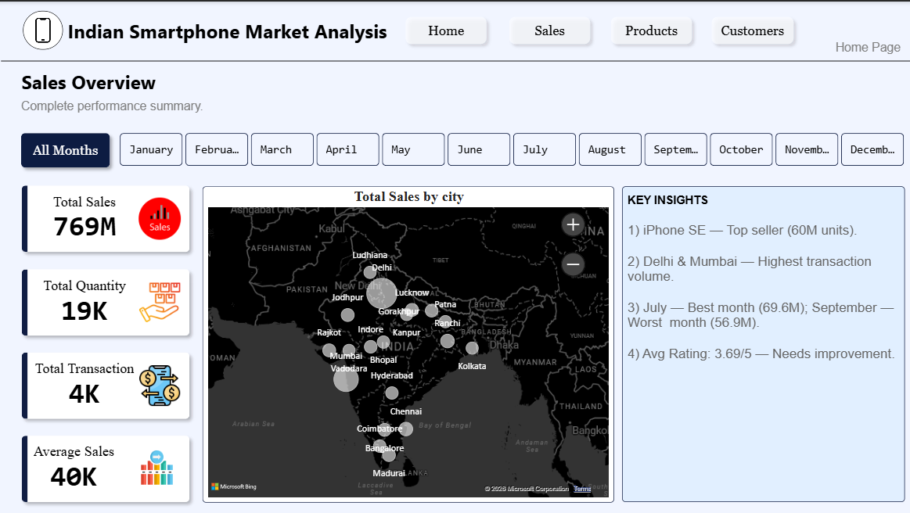
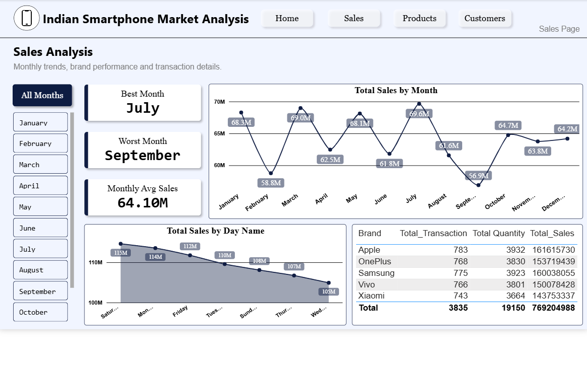
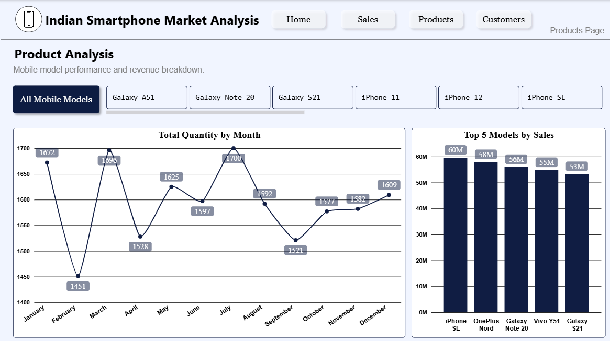
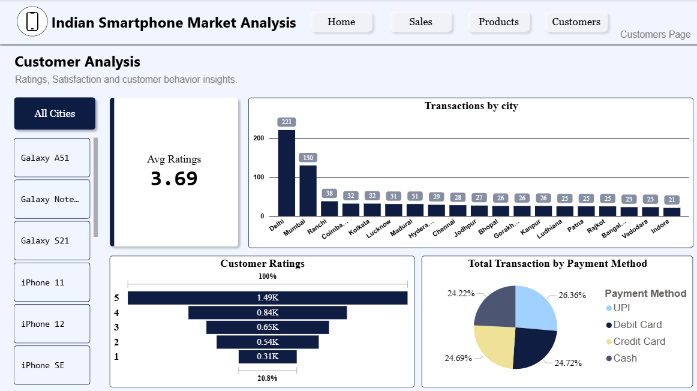

# Indian Smartphone Market Analysis Dashboard | Power BI

An interactive Power BI dashboard analyzing smartphone sales, product performance, and customer behavior across major Indian cities.

## Project Overview

This dashboard provides a comprehensive analysis of smartphone sales performance and customer preferences in the Indian market.

The analysis focuses on:

- Overall sales performance and trends
- Brand-wise and model-wise product analysis
- Customer ratings and satisfaction
- Payment method preferences
- City-wise transaction and revenue distribution

## Key Business Insights

- **Top-Selling Model:** iPhone SE emerged as the leading smartphone model, with 60M units sold.
- **Leading Cities:** Delhi and Mumbai recorded the highest transaction volumes.
- **Monthly Sales Performance:** July was the best-performing month, generating 69.6M in sales, while September recorded the lowest sales at 56.9M.
- **Customer Satisfaction:** The average customer rating stands at 3.69 out of 5, indicating opportunities to improve customer experience.
- **Customer Preferences:** The dashboard provides insights into payment method preferences and smartphone purchasing behavior.

## Dashboard Pages

### 1. Home / Sales Overview

Provides a high-level summary of sales performance, including KPIs, geographic sales distribution, and key business metrics.

### 2. Sales Analysis

Analyzes monthly sales trends, brand performance, and transaction details to identify changes in market performance.

### 3. Product Analysis

Evaluates smartphone model performance, quantity trends, and top-selling products to identify popular products and purchasing patterns.

### 4. Customer Analysis

Explores customer ratings, satisfaction levels, and payment method distribution to understand customer behavior and preferences.

## Tools & Technologies

- **Microsoft Power BI Desktop** — Dashboard development and data visualization
- **DAX** — KPI calculations and analytical measures
- **Power Query** — Data transformation and preparation
- **Data Visualization** — Business reporting and dashboard storytelling

## Project Files

- `Indian-Smartphone-Market-Analysis-Dashboard.pbix` — Interactive Power BI project file
- `Home.png` — Home and sales overview screenshot
- `Sales.png` — Sales analysis screenshot
- `Products.png` — Product analysis screenshot
- `Customers.png` — Customer analysis screenshot

## Project Objective

This project was developed as a practical application of data analytics and business intelligence concepts.

The objective was to transform raw smartphone sales data into meaningful insights, identify market trends, and communicate business performance through effective dashboard storytelling.

## Author

**Pranav Satalkar**

Power BI | Data Analytics | Business Intelligence
